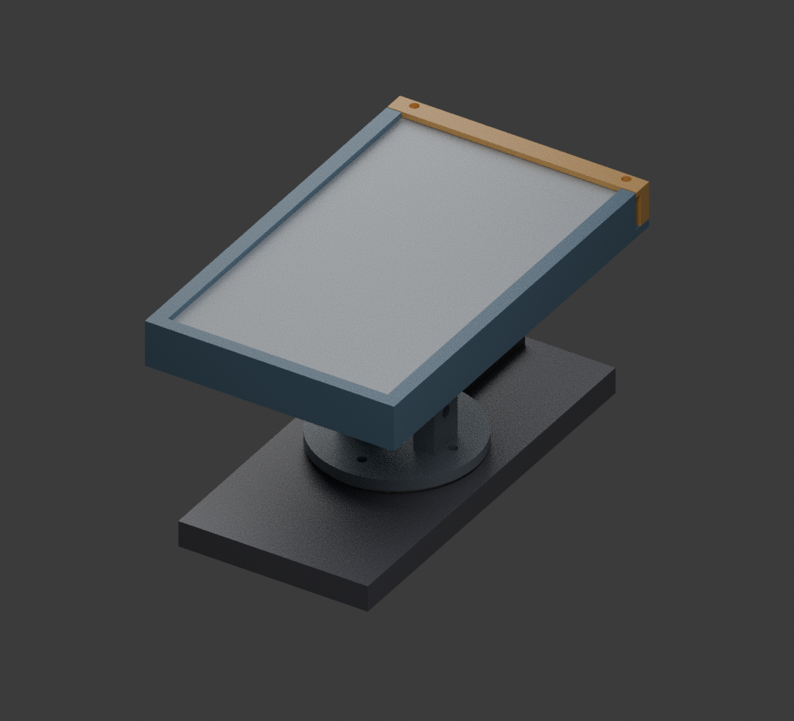
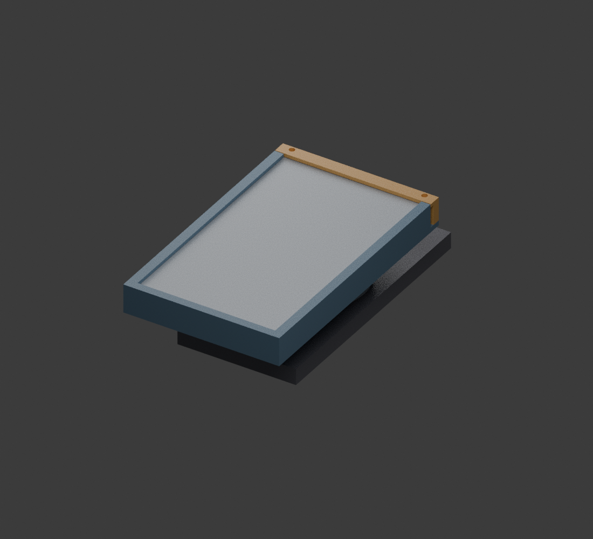
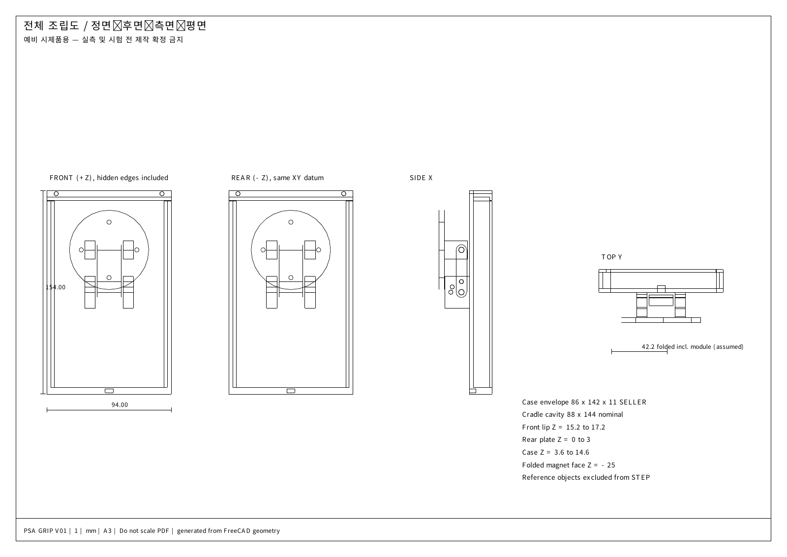

# pokemon

## 3D 프린트 전달용 패키지

프린터 모델이 아직 없어도 아래 ZIP을 출력 업체에 전달해 시제품 견적·출력을 검토할 수 있습니다.

- **[프린트 전달용 ZIP 다운로드](https://github.com/psh30427-ops/pokemon/raw/refs/heads/main/deliverables/psa_grip_print_v01.zip)**
- [출력 의뢰서 PDF — 먼저 읽기](deliverables/psa_grip_print_v01/01_PRINT_ORDER_ko.pdf)
- [출력용 STL 4개](deliverables/psa_grip_print_v01/STL_PRINT)
- [부품별 A3 도면](deliverables/psa_grip_print_v01/PDF_DRAWINGS)
- [패키지 사용 안내](deliverables/psa_grip_print_v01/README_ko.md)

각 부품 1개, 단위 mm, 배율100%. STL은 제안 출력 방향과 Z=0으로 정리되어 있습니다. 장비별 서포트와 출력 방향은 출력 업체가 확인해야 합니다. PDF는 참고 도면이며 프린터 입력 파일은 STL입니다. 기종이 미정이라 G-code는 포함하지 않았습니다. **실측·실물 시험 전 예비 시제품이며 자석 모듈 체결 규격은 아직 미확정입니다.**

## PSA 보호케이스 그립 — 예비 시제품 V01

실제 PSA 보호케이스 전체를 손잡이로 사용하는 접이식 스마트폰 액세서리의 CAD 및 도면입니다.

**실측 및 실물 시험 전 제작 확정 금지.** 자석식 보호케이스의 앞뒤를 크래들이 함께 잡는 구조입니다. 휴대폰 부착용 자석 모듈 체결 규격·고정력 및 실물 강도는 아직 미검증입니다. 가정값 기준 접힌 두께 약 42mm, 휴대폰 포함 질량 약 499g으로 경량화와 두께 개선이 필요합니다.

### 미리보기

펼친 상태:

접힌 상태:

조립 도면:

### 다운로드 및 설명

- [전체 파일 ZIP](deliverables/psa_grip_v01.zip)
- [A3 도면 PDF — 7장](deliverables/psa_grip_v01/drawings/PSA_grip_A3.pdf)
- [FreeCAD 원본](deliverables/psa_grip_v01/assembly.FCStd)
- [조립 STEP](deliverables/psa_grip_v01/assembly.step)
- [부품별 STL·STEP](deliverables/psa_grip_v01/parts)
- [생성 방법과 파일 안내](deliverables/psa_grip_v01/README_ko.md)
- [조립 안내](deliverables/psa_grip_v01/assembly_guide_ko.md)
- [BOM](deliverables/psa_grip_v01/BOM.csv)
- [검증 보고서](deliverables/psa_grip_v01/validation_report_ko.md)

파일 화면에서 **Download raw file** 버튼으로 내려받을 수 있습니다. 이미지의 회색 케이스와 휴대폰은 크기 확인용 외형 모델입니다.

실제 실행한 검증: 제작품 4개 단일 닫힌 솔리드, STEP 재가져오기, STL 닫힘·크기, 0~90도 5도 간격의 19개 상태에서 모델 간 체적 겹침 0건. 손가락·실제 체결품·실물 자석·실제 제품 곡면은 이 간섭 검증에 포함되지 않습니다.
