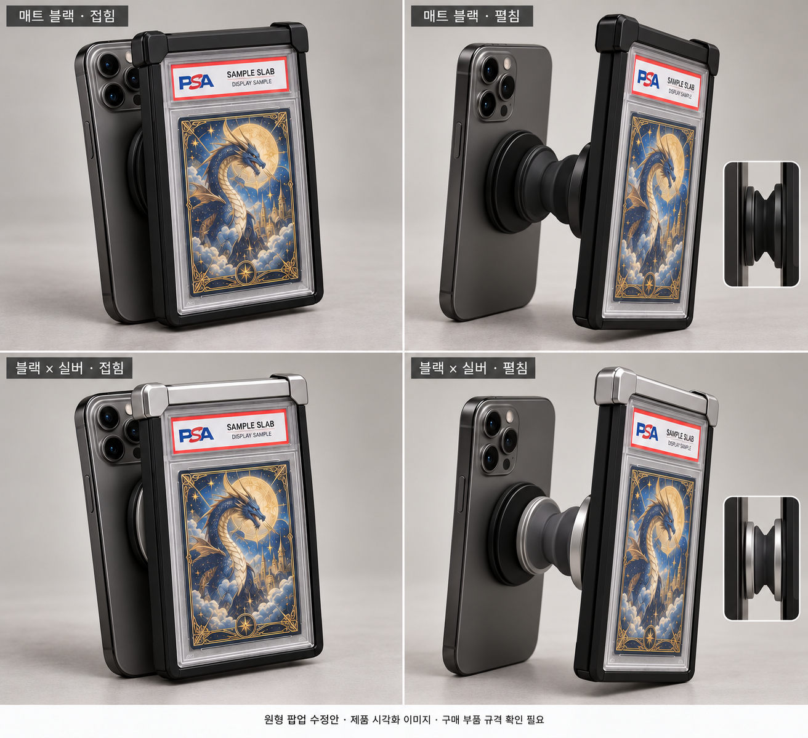
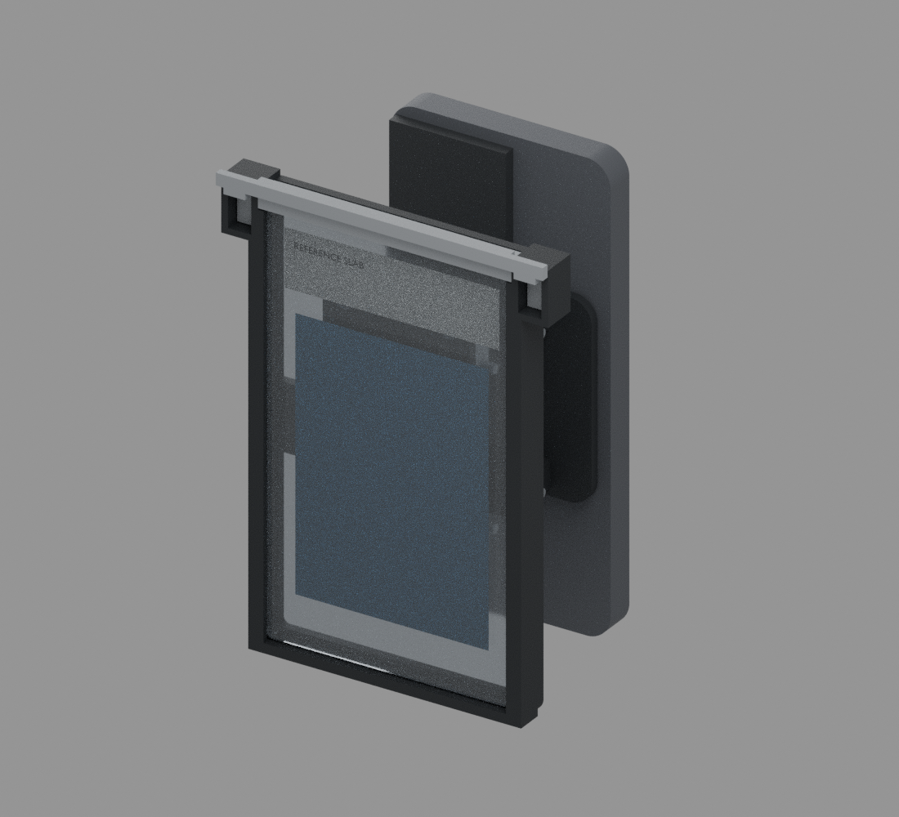
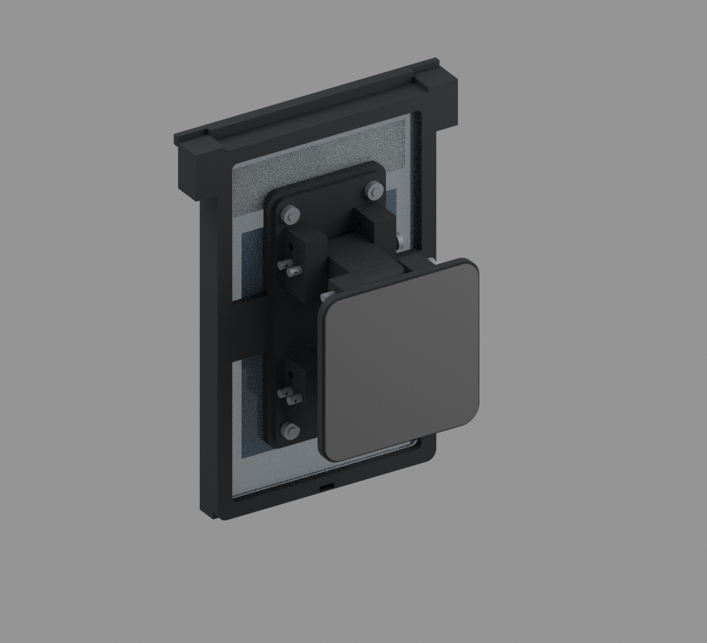
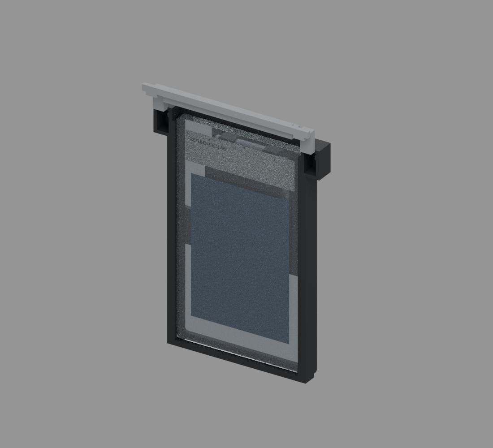

# pokemon

## 최신 수정 — 빨간 범퍼·검은 완충부 초경량 V02

참고 이미지의 얇은 사각 범퍼를 적용하고, **자석 교체 게이트 + 뒷면 원형 팝업 + 폰 케이스 접착**으로 구성했습니다. B안에는 하중 전달용 뒤쪽 T리브가 있습니다. 실제 CAD로 생성한 예비 시제품이며 실측·실물 시험 전 제작 확정 금지입니다.

- [**최신 파일·제작 설명**](deliverables/psa_grip_v02/ultralight_revision/README_ko.md)
- [B안 FreeCAD·STEP](deliverables/psa_grip_v02/ultralight_revision/B_daily/CAD) / [출력용 STL](deliverables/psa_grip_v02/ultralight_revision/B_daily/STL_PRINT)
- [A3 제작 도면 6장 PDF](deliverables/psa_grip_v02/ultralight_revision/B_daily/drawings/Ultralight_A3_Manufacturing.pdf)
- [A/B/C 무게 비교](deliverables/psa_grip_v02/ultralight_revision/comparison_ko.md) / [검증 보고서](deliverables/psa_grip_v02/ultralight_revision/validation_report_ko.md)
- [후면](deliverables/psa_grip_v02/ultralight_revision/B_daily/renders/red_rear_open.png) / [접힘](deliverables/psa_grip_v02/ultralight_revision/B_daily/renders/red_folded_phone.png) / [펼침](deliverables/psa_grip_v02/ultralight_revision/B_daily/renders/red_open_phone.png) / [분해](deliverables/psa_grip_v02/ultralight_revision/B_daily/renders/red_rear_exploded.png)
- [전체 파일 ZIP 다운로드](https://github.com/psh30427-ops/pokemon/raw/refs/heads/main/deliverables/psa_grip_v02/PSA_Grip_Ultralight_Revision.zip)

추가 부품 무게는 A **23.55g**, B **30.20g**, C **37.91g**(팝업8g, CAD 체적·가정 밀도 기준). A는 얇은 리브 강도 우려로 실사용 추천에서 제외합니다. B를 개발 후보로 권장하되, 30g 이하는 팝업 **7.80g 이하**의 부품 선정과 완성품 실측이 필요합니다. 슬랩50g 가정 시 B 총80.20g입니다. 구매 팝업은 미선정 참고 형상이며 기구 STL을 제공하지 않습니다. 자석·접착·강도·피로·낙하는 미검증입니다. 기존 V01·V02는 아래에 보존합니다.

## 이전 수정 — 중앙 원형 팝업 연결부

노출된 두 링크와 회전축 브래킷을 제거하고, 프레임 뒷면 중앙의 원형 연결면 → 상용 원형 팝업 → 원형 접착 베이스로 변경했습니다. 상단 자석 게이트, 카드 앞면 바깥 방향, 폰 케이스 접착 방식은 유지합니다.

**[수정한 완성품 예상 이미지 크게 보기](deliverables/psa_grip_v02/circular_popup_revision/finished_product_circular_concept.png)**

위 사진은 AI 제품 시각화로 CAD 치수·세부와 다를 수 있습니다. 아래는 실제 수정 CAD와 구분되는 자료입니다.

- [원형 팝업 수정안 설명](deliverables/psa_grip_v02/circular_popup_revision/README_ko.md)
- [실제 CAD 기반 후면 렌더링](deliverables/psa_grip_v02/circular_popup_revision/renders/silver_rear_open.png)
- [슬랩 직접 수납형 수정 CAD·STEP](deliverables/psa_grip_v02/circular_popup_revision/CAD)
- [알루미늄 보호케이스형 수정 CAD·STEP](deliverables/psa_grip_v02/circular_popup_revision/variants/aluminum_case/CAD)
- [원형 수정안 도면 PDF](deliverables/psa_grip_v02/circular_popup_revision/drawings/Circular_Popup_Revision_A3.pdf)
- [원형 수정안 ZIP 다운로드](https://github.com/psh30427-ops/pokemon/raw/refs/heads/main/deliverables/psa_grip_circular_popup_revision.zip)

팝업은 **구매품 규격 미선정인 외형 참고 모델**입니다. 주름 기구의 STL은 제공하지 않으며, 새 프레임·게이트·원형 폰 베이스만 출력합니다. OEM 부품과 접착면을 선정/실측/시험한 뒤 연결부를 확정해야 합니다. 현재 가정으로 A안 접힘26.9/펼침42.9mm, B안31.9/47.9mm. 실물 강도·팝업 작동·접착 유지력 미검증.

이전 링크형 CAD와 이미지는 아래에 보존했습니다.

## 이전 링크형 V02 — 자석 교체 게이트 + 접착식 폰 베이스, 두 가지 수납안

**이번 V02는 실제 링크/축/자석 포켓을 설계한 예비 시제품입니다. 실측 및 실물 시험 전 제작 확정 금지.**

- **A안:** PSA 슬랩 직접 수납.81×136×6mm는 전부 가정값이며 실제PSA공식규격 확인값이 아닙니다.
- **B안:** 기존 알루미늄 보호케이스 수납.86×142×11mm는 판매자 참고이며 실측이 아닙니다.
- **카드 교체:** 고정핀 없는 자석 게이트. 바깥쪽으로 들어올리고 위로 분리. 두 자석쌍과 두 기계적 끝벽.
- **그립:** 링크2개/회전축4개,0·90도 각도핀2개. 카드교체용 고정핀과 내부 회전축핀은 다릅니다.
- **폰 연결:** 폰 케이스와 베이스 사이 접착식. 하부 축핀2개로 본체를 분리하면 베이스는 케이스에 남습니다.
- **색상:** 매트 블랙 / 블랙×티타늄 실버. 실버는 필라멘트 색상입니다.

자석·접착 유지력/실물 출력·강도·거치는 미검증입니다. A안은 게이트 돌출 포함 접힘약35.5/펼침63.5mm, B안은약40.5/68.5mm의 큰 시제품 기구입니다. 최종값과가정은 보고서를 확인하세요. 주름형 소형 상용그립과 같은 두께라고 주장하지 않습니다.

### 완성품 예상 이미지

[**이미지 크게 보기**](deliverables/psa_grip_v02/product_visualization/finished_product_concept.png)

위 이미지는 AI 제품 시각화이며 실제 CAD 렌더링/제작 도면이 아닙니다. 아래 CAD 렌더링과 구분해 주세요.

### 미리보기

A안 투톤, 카드 앞면이 바깥쪽을 향한 폰 장착:

A안 매트 블랙 후면:

슬랩·카드/라벨은 중립적 참고표현이며 실물 치수/인증/광학 성능 증거가 아닙니다. CAD 형상에서 직접 렌더링했습니다.

게이트를 연 상태:

### 파일 받기

- **[두 안 전체 ZIP 다운로드](https://github.com/psh30427-ops/pokemon/raw/refs/heads/main/deliverables/psa_grip_v02.zip)**
- [구조 변경 및 V01 분석](deliverables/psa_grip_v02/DESIGN_CHANGES_ko.md)
- [A안 설명](deliverables/psa_grip_v02/README_ko.md) / [B안 설명](deliverables/psa_grip_v02/variants/aluminum_case/README_ko.md)
- [A안 A3 제작 도면10장](deliverables/psa_grip_v02/drawings/PSA_Grip_V02_Manufacturing_A3.pdf)
- [B안 A3 제작 도면10장](deliverables/psa_grip_v02/variants/aluminum_case/drawings/PSA_Grip_V02_Manufacturing_A3.pdf)
- [A안 출력용 STL](deliverables/psa_grip_v02/STL_PRINT) / [B안 출력용 STL](deliverables/psa_grip_v02/variants/aluminum_case/STL_PRINT)
- [A안 조립/출력 안내PDF](deliverables/psa_grip_v02/drawings/Assembly_and_Print_Guide_ko.pdf)
- [A안 FreeCAD](deliverables/psa_grip_v02/PSA_Grip_V02.FCStd) / [A안 STEP](deliverables/psa_grip_v02/PSA_Grip_V02_Assembly.step)
- [A안 검증 보고서](deliverables/psa_grip_v02/validation_report_ko.md) / [B안 검증 보고서](deliverables/psa_grip_v02/variants/aluminum_case/validation_report_ko.md)
- [이전 아이보리 구매팝업 개념 V02 원본 보관](deliverables/archive/psa_grip_v02_case_concept)

**출력 수량:**01/02/03/05 각1개,04 링크2개,06 TPU측면라이너2개. PDF는 참조 도면이고 실제 슬라이서 입력은 `STL_PRINT`입니다. 자석/금속핀/R클립/M3/심·패드/폰 접착제는 별도 구매합니다.

## V01 프린트 전달용 패키지 — 이전 설계

프린터 모델이 아직 없어도 아래 ZIP을 출력 업체에 전달해 시제품 견적·출력을 검토할 수 있습니다.

- **[프린트 전달용 ZIP 다운로드](https://github.com/psh30427-ops/pokemon/raw/refs/heads/main/deliverables/psa_grip_print_v01.zip)**
- [출력 의뢰서 PDF — 먼저 읽기](deliverables/psa_grip_print_v01/01_PRINT_ORDER_ko.pdf)
- [출력용 STL 4개](deliverables/psa_grip_print_v01/STL_PRINT)
- [부품별 A3 도면](deliverables/psa_grip_print_v01/PDF_DRAWINGS)
- [패키지 사용 안내](deliverables/psa_grip_print_v01/README_ko.md)

각 부품 1개, 단위 mm, 배율100%. STL은 제안 출력 방향과 Z=0으로 정리되어 있습니다. 장비별 서포트와 출력 방향은 출력 업체가 확인해야 합니다. PDF는 참고 도면이며 프린터 입력 파일은 STL입니다. 기종이 미정이라 G-code는 포함하지 않았습니다. **실측·실물 시험 전 예비 시제품이며 자석 모듈 체결 규격은 아직 미확정입니다.**

## PSA 보호케이스 그립 — 예비 시제품 V01

실제 PSA 보호케이스 전체를 손잡이로 사용하는 접이식 스마트폰 액세서리의 CAD 및 도면입니다.

**실측 및 실물 시험 전 제작 확정 금지.** 자석식 보호케이스의 앞뒤를 크래들이 함께 잡는 구조입니다. 휴대폰 부착용 자석 모듈 체결 규격·고정력 및 실물 강도는 아직 미검증입니다. 가정값 기준 접힌 두께 약 42mm, 휴대폰 포함 질량 약 499g으로 경량화와 두께 개선이 필요합니다.

### 미리보기

펼친 상태:

접힌 상태:

조립 도면:

### 다운로드 및 설명

- [전체 파일 ZIP](deliverables/psa_grip_v01.zip)
- [A3 도면 PDF — 7장](deliverables/psa_grip_v01/drawings/PSA_grip_A3.pdf)
- [FreeCAD 원본](deliverables/psa_grip_v01/assembly.FCStd)
- [조립 STEP](deliverables/psa_grip_v01/assembly.step)
- [부품별 STL·STEP](deliverables/psa_grip_v01/parts)
- [생성 방법과 파일 안내](deliverables/psa_grip_v01/README_ko.md)
- [조립 안내](deliverables/psa_grip_v01/assembly_guide_ko.md)
- [BOM](deliverables/psa_grip_v01/BOM.csv)
- [검증 보고서](deliverables/psa_grip_v01/validation_report_ko.md)

파일 화면에서 **Download raw file** 버튼으로 내려받을 수 있습니다. 이미지의 회색 케이스와 휴대폰은 크기 확인용 외형 모델입니다.

실제 실행한 검증: 제작품 4개 단일 닫힌 솔리드, STEP 재가져오기, STL 닫힘·크기, 0~90도 5도 간격의 19개 상태에서 모델 간 체적 겹침 0건. 손가락·실제 체결품·실물 자석·실제 제품 곡면은 이 간섭 검증에 포함되지 않습니다.
