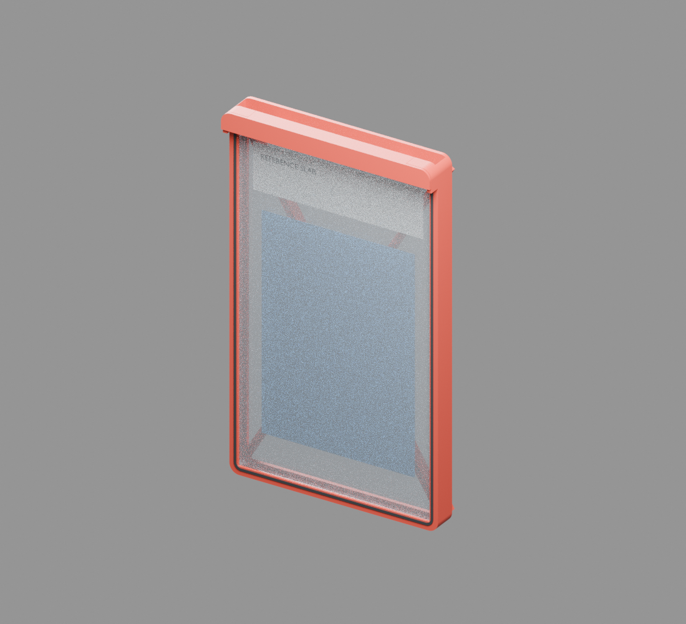
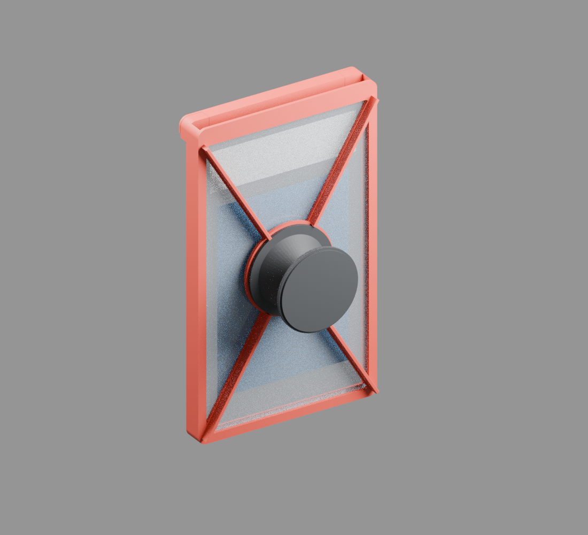

# 빨간 범퍼·검은 완충부 초경량 V02 수정안

[추천 B안 CAD](B_daily/CAD) · [출력 STL](B_daily/STL_PRINT) · [A3 도면 PDF](B_daily/drawings/Ultralight_A3_Manufacturing.pdf) · [무게 비교](comparison_ko.md) · [검증 보고서](validation_report_ko.md)





사용자가 올린 단순한 빨간 사각 범퍼와 검은 내부 테두리 이미지를 반영했습니다. 앞면과 뒷면은 열고, 뒤쪽 중앙의 작은 원형 접착면과 하중 전달 리브만 남겼습니다. 카드 앞면은 바깥쪽, 원형 팝업은 뒷면입니다. 스마트폰 연결은 폰 케이스에 접착하는 방식입니다.

상단 게이트는 두 쌍의 자석으로 닫으며 기계적 어깨와 두 개의 슬랩 스토퍼가 위쪽 이탈을 막습니다. 앞쪽(+Z)으로 게이트를 들어올리는 방향은 자석에 의존합니다. 작은 자석의 유지력은 미확인으로, 아래 시험에 실패하면 자석 확대 또는 별도 안전 걸쇠를 재설계해야 합니다. 자석 고정력을 검증한 제품으로 사용할 수 없습니다.

사진의 연속 테두리를 유지하면서 게이트에는 국부 두께 증가가 있습니다. 사진처럼 모든 위치가 같은 얇은 단면은 아닙니다. B안 뒷면에는 하중 때문에 T형 리브를 추가했습니다. 이는 실제 CAD에 포함됩니다.

슬랩 직접 수납형입니다. 알루미늄 케이스형은 기존 `../circular_popup_revision/variants/aluminum_case/`에 보존했으며 이 무게 표의 대상이 아닙니다. V01과 기존 V02 파일은 변경하지 않았습니다.

## 치수와 자료의 의미

81×136×6mm, 모서리 R3, 슬랩 50g(35~80g 범위)은 모두 ASSUMED입니다. 보내주신 실리콘 보호케이스 85×140×9mm/14g, 아크릴 슬롯 137×82.5×8mm, 35장 보관함 치수는 슬랩 자체의 실측이 아닙니다. 14g은 실리콘 보호케이스 단품 참고값이며 본 제품의 팝업·자석·접착재 포함 무게와 직접 비교할 수 없습니다. 86×142×11mm도 기존 알루미늄 보호케이스 판매자 값입니다. 판매자 내경80×135mm의 용도는 확인되지 않았습니다.

참고 폰+케이스는 71.5×149.6×9.75mm/224g, 카메라 돌출4mm로 가정했습니다. 카메라·MagSafe 위치의 공식 기구 도면을 확보하지 않았습니다. 이번 설계는 MagSafe 부착을 사용하지 않습니다. 표준·공식 인증을 주장하지 않습니다.

## 실제 생성 파일과 재현

`A_minimum/`, `B_daily/`, `C_protective/` 각각에 다음 파일이 있습니다.

- `CAD/PSA_Grip_Ultralight.FCStd`: FreeCAD 1.0 원본(부품 형상과 파라미터 시트).
- `CAD/Printed_Assembly.step`, `CAD/Assembly_With_OEM_Reference.step`.
- `STEP_parts/*.step`: 개별 PETG 및 TPU 부품.
- `STL_PRINT/*.stl`: mm, 출력 방향을 적용하고 바닥 Z=0으로 이동한 닫힌 메시.
- `drawings/Ultralight_A3_Manufacturing.pdf`: A3 6장, 조립·전후면·측면·평면·단면·분해·부품 치수·조립 안내.
- `BOM.csv`, `validation_results.json`, `assembly_guide_ko.md`.
- `renders/*.png`: 실제 CAD 메시로 만든 Blender 렌더링. 중립적인 가상 슬랩과 카드 표현이며 실물 PSA 사진이 아닙니다.

출력 대상은 프레임·게이트·TPU 부품입니다. A/B안은 추가 출력 베이스를 제거하고 구매 팝업의 하부 캡을 접착 베이스로 사용합니다. C안만 별도 PETG 베이스가 있습니다. 구매 팝업의 주름부·기구 STL은 제공하지 않습니다. 미선정 상용 원형 팝업 외형의 닫힘6/열림22mm는 참고 가정이며, 이 모형이 실제로 작동하는 것을 검증하지 않았습니다.

```bash
# Debian/Ubuntu 계열, FreeCAD Python 모듈 및 python3-reportlab / Blender 필요
/usr/bin/python3 generate_ultralight.py --skip-render
# 위 명령 뒤 실제 CAD 메시로 렌더링
/usr/bin/blender -b -t 4 --python render_blender.py
# CAD만 빠르게 다시 생성
/usr/bin/python3 generate_ultralight.py --geometry-only --skip-render
```

먼저 이 폴더를 새 작업 폴더로 복사하고 `parameters.json`을 편집하세요. 생성 스크립트는 자신의 A/B/C 출력 폴더를 다시 씁니다. `design_specs.json`은 생성 결과이며 설계안 변경은 스크립트의 SPECS를 수정합니다. FreeCAD의 파라미터 시트는 기록용으로, 시트 값을 바꾸면 형상이 자동 재계산되는 식 연결 모델은 아닙니다. 형상 변경은 Python으로 재생성해야 합니다. 형상 변경 뒤에는 `--geometry-only`로 끝내지 말고 전체 생성 명령을 실행해 도면·BOM·보고서를 갱신하세요. 전체 생성은 마지막에 `verify_exports.py` 파일 재검사를 실행합니다. 렌더링을 생략했다면 별도로 다시 실행해야 이미지도 바뀝니다. 자석은 현재 D3×1.5mm 4개만 지원하며 다른 규격은 게이트와 포켓 형상 재설계가 필요합니다. 프린터가 미정이므로 G-code는 만들지 않았습니다.
